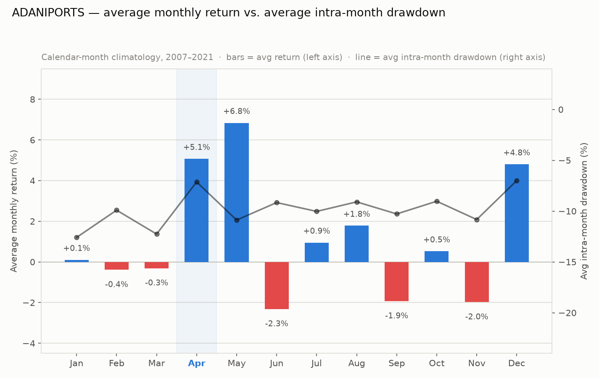
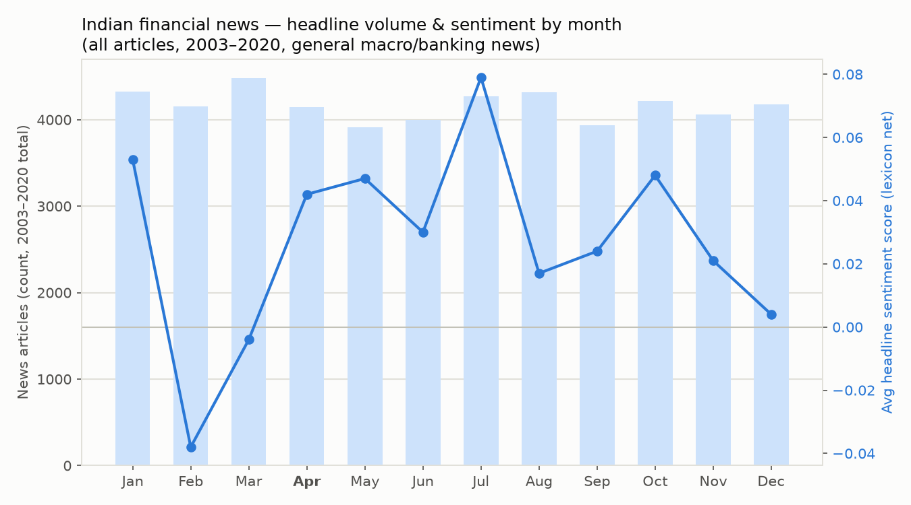
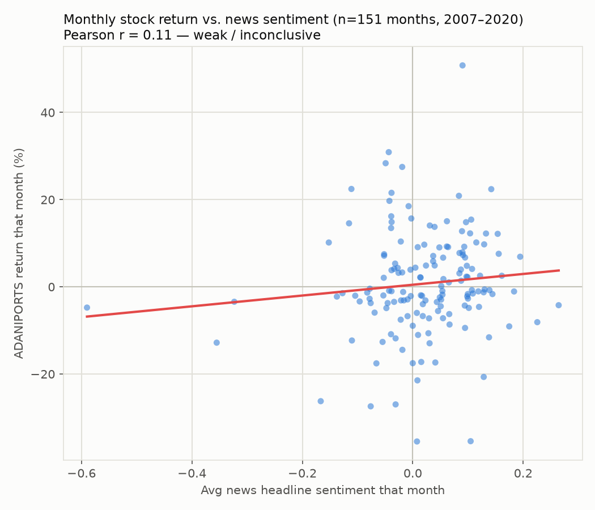
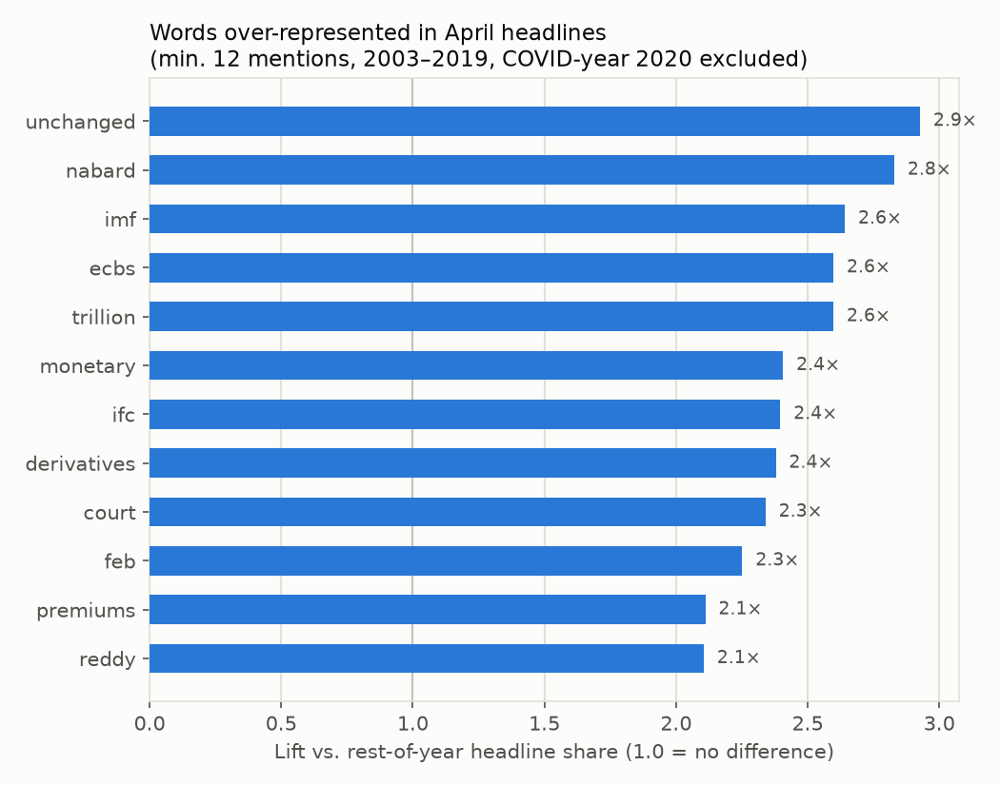

# ADANIPORTS: Why April Looks Different

*A follow-up to the main EDA, digging into the calendar-month seasonality finding —
April combines the mildest drawdowns with some of the strongest returns — and
checking it against `IndianFinancialNews.csv` (50,000 headlines, Feb 2003–May 2020,
listed newest-first).*

---

## TL;DR

- April really is the outlier: **smallest average intra-month drawdown (-7.1%)**
  and **smallest worst-case intra-month drawdown (-13.8%)** of any month, paired
  with a **+5.1% average return** and the **highest hit-rate of positive months
  (64%)**. December is the only close competitor.
- The news dataset is **general Indian financial/macro news** (heavily RBI/banking),
  **not Adani-specific** — only 63 of 50,000 headlines even mention "Adani" or
  "Mundra," and almost all of those are about a former RBI deputy governor named
  S. S. Mundra, not the company. So this can only test a market-wide-sentiment
  hypothesis, not a company-specific one.
- News **sentiment barely correlates** with next-month-ish stock returns at all
  (Pearson r = 0.11 across 151 overlapping months) — the April effect is **not
  explained by the tone of financial news**.
- What April headlines actually over-index on: **RBI's monetary policy language**
  ("unchanged," "monetary," "eases") and **NABARD's annual statements** — both
  scheduled, non-surprise events tied to the start of India's fiscal year (April 1).
  That's a plausible structural reason for calmer news flow, even if it isn't a
  sentiment effect.

---

## 1. The April effect, quantified

Calendar-month climatology across all Novembers 2007–Aprils 2021 (13–14
observations per month):

| Month | Avg return | Median return | % positive months | Avg intra-month drawdown | Worst intra-month drawdown | n |
|---|---:|---:|---:|---:|---:|---:|
| Jan | +0.1% | +3.94% | 57% | −12.6% | −43.7% | 14 |
| Feb | −0.4% | −2.63% | 29% | −9.9% | −21.6% | 14 |
| Mar | −0.3% | +0.19% | 50% | −12.3% | −40.5% | 14 |
| **Apr** | **+5.1%** | **+1.96%** | **64%** | **−7.1%** | **−13.8%** | 14 |
| May | +6.8% | +3.10% | 62% | −10.9% | −27.2% | 13 |
| Jun | −2.3% | −1.25% | 38% | −9.2% | −35.5% | 13 |
| Jul | +0.9% | −0.75% | 46% | −10.0% | −18.6% | 13 |
| Aug | +1.8% | +0.17% | 54% | −9.1% | −15.9% | 13 |
| Sep | −1.9% | −2.02% | 38% | −10.3% | −28.5% | 13 |
| Oct | +0.5% | +1.39% | 54% | −9.0% | −22.0% | 13 |
| Nov | −2.0% | −1.89% | 36% | −10.8% | −28.7% | 14 |
| Dec | +4.8% | +0.74% | 50% | −7.0% | −10.4% | 14 |

May actually edges out April on raw average return (+6.8% vs +5.1%), but May's
average and worst-case drawdowns (−10.9% / −27.2%) are both roughly **twice as
deep** as April's. April is the best *risk-adjusted* month by a clear margin —
strong returns delivered with the calmest ride. December is the only other month
in the same league on drawdown.

---

## 2. Does the news calendar explain it?

`IndianFinancialNews.csv` has no sentiment score, so one was built with a small
hand-curated finance-lexicon (~120 positive/negative words — "surge," "rally,"
"upgrade" vs. "crash," "default," "slowdown," etc.). Each headline gets a net
score (positive-word count minus negative-word count); scores are averaged per
month. This is a blunt instrument, not a trained sentiment model — treat it as
directional, not precise.

Aggregated across all 18 years the dataset covers (article volume and average
headline sentiment, independent of which year):

April sits mid-pack on volume but has one of the **more positive average
sentiment scores** and the **third-lowest share of negative headlines (13.6%)**
of any month — consistent in direction with the stock's calmer April, but the
gap between months here is small next to the noise in a 120-word lexicon.

---

## 3. Testing it directly: sentiment vs. same-month return

Pooling every (year, month) pair present in both datasets (151 months, 2007–2020 —
the news data stops in May 2020, so 2021 isn't covered here):

**Pearson r = 0.11.** That's a weak, barely-there relationship — news tone this
crude explains almost none of the month-to-month variation in returns. Article
*volume* correlates even less (r = −0.04). This is a fairly clean null result:
**generic financial-news sentiment is not driving the April pattern.**

---

## 4. What April headlines are actually about

Comparing April headlines to every other month's (2020 excluded, since COVID
news would swamp everything else that April), the words most over-represented
in April are:

The cluster is telling: **"unchanged," "monetary," "eases," "nabard," "reddy"**
(a former RBI governor) point at the **RBI's first monetary policy review of the
new fiscal year**, which by convention falls in the first week of April, plus
**NABARD's annual policy statement**, also an April fixture. Both are scheduled,
pre-anticipated events rather than shocks — the kind of news that resolves
uncertainty rather than creating it. That's a more plausible structural
explanation for a calmer April than any sentiment effect: less *surprise* news,
not more *positive* news.

---

## 5. Honest limitations

- **Not company-specific.** This news feed is dominated by RBI/banking-sector
  coverage. It says something about the Indian financial-news cycle in general,
  not about Adani Ports specifically.
- **Small samples.** 14 Aprils, 13–14 observations for most months — a couple of
  unusual years can move these averages a lot (2008's crash sits inside nearly
  every month's statistics).
- **Lexicon sentiment is crude.** No negation handling ("not weak" scores as
  negative), no context, no weighting by headline prominence.
- **Date coverage mismatch.** Stock data runs to April 2021; news data stops
  May 2020, so the last ~11 months of the stock series have no corresponding
  news rows.
- **Correlation, not causation, even where it's non-zero.** r = 0.11 is weak
  enough that it shouldn't be read as evidence of any real relationship at all.

**Bottom line:** the April effect is real and fairly large in this stock's
history, but it looks like a *calendar/structural* pattern (fiscal-year-start
mechanics, a scheduled and uneventful RBI policy review, whatever else clusters
around India's April fiscal year-open) rather than something driven by how
positively or negatively the financial press was writing that month.

---

## Method notes

- Stock-side numbers reuse the split-adjusted ADANIPORTS series from the main
  EDA (5:1 split on 23 Sep 2010 adjusted for; see that report's Data Notes).
- News dates parsed from `"Month DD, YYYY, Weekday"` format; 50,000 rows, 0
  unparseable.
- Sentiment lexicon and all aggregation code: plain pandas, no external NLP
  libraries. Charts: matplotlib. Scripts were run ad hoc, not saved as a
  pipeline — re-run on request.
- Charts saved alongside this file in `seasonality_charts/`.
