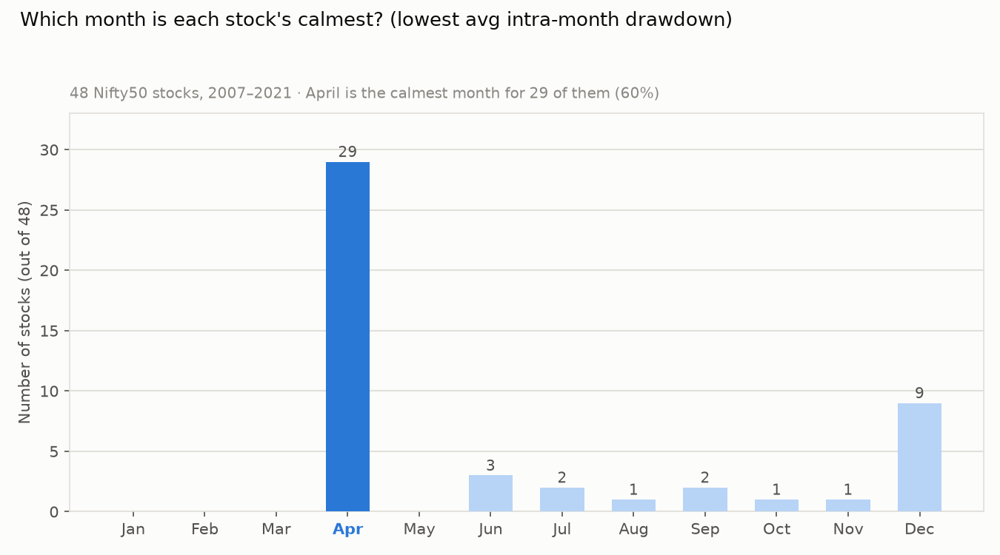
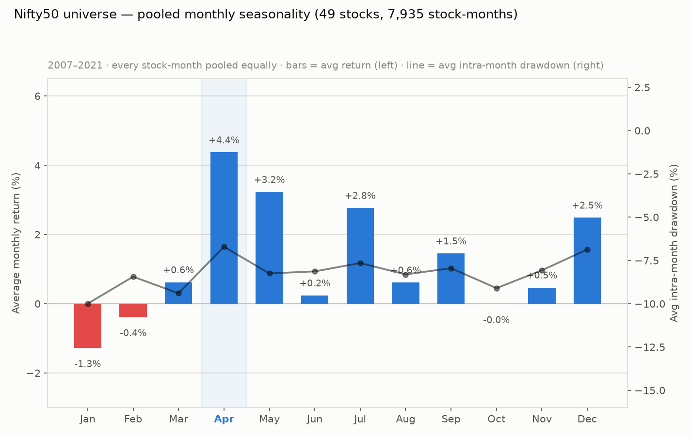
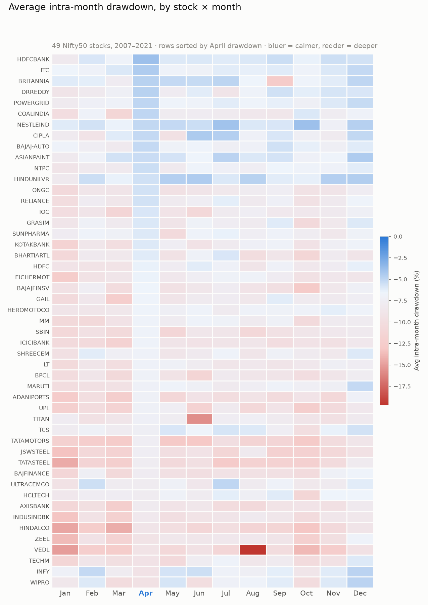
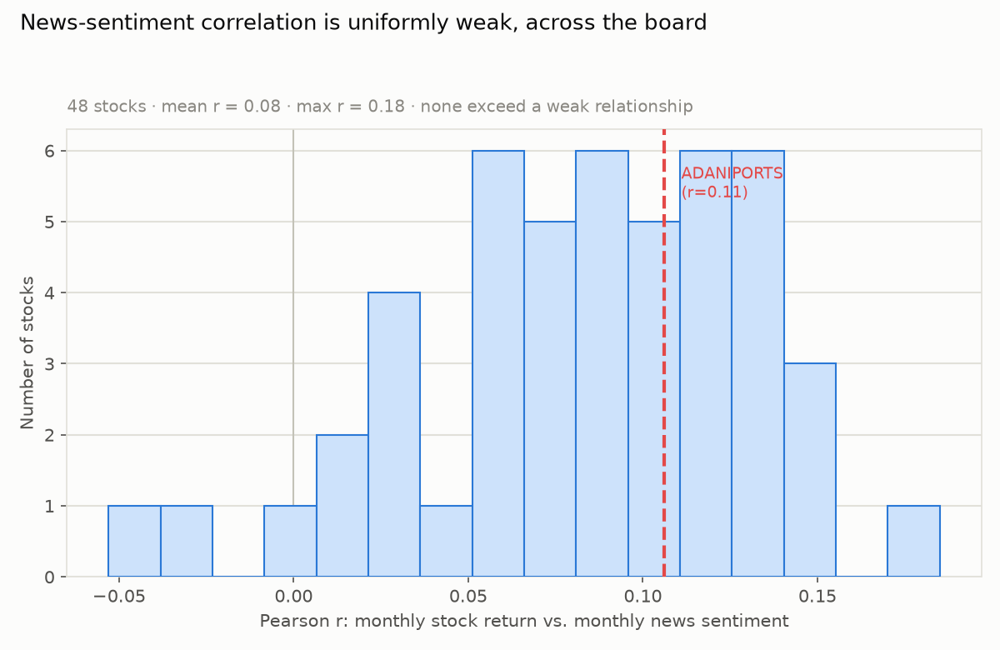

# The April Effect, Market-Wide

*Same method as [`ADANIPORTS_april_seasonality.md`](ADANIPORTS_april_seasonality.md),
applied to the other 48 Nifty50 constituents in this folder. Question: is Adani
Ports' "April is calm, returns are strong" pattern a fluke of one stock, or does
it hold across the market?*

**It holds — broadly, strongly, and it is not explained by news sentiment.**

---

## TL;DR

- **April is the single calmest month (lowest average intra-month drawdown) for
  29 of 48 stocks (60%)** — and the best-return month for 16 of 48. For 14 stocks
  it's *both* simultaneously. Random chance would predict roughly 4 and 0.3
  stocks respectively — this is not noise.
- **Pooled across all 49 stocks and 7,935 stock-months (2007–2021)**, April
  averages **+4.4% return** against every other month's **+3.2% or less**, while
  its average intra-month drawdown (**−6.7%**) is the shallowest of any month.
- **It's sector-split, cleanly.** April is the calmest month for **100% of
  Metals, Fertiliser/Pesticide, and Construction stocks**, 86% of Energy, and
  67% of Financials and Pharma — but **0% of IT, Telecom, and Media** stocks.
  All five IT majors (Infosys, TCS, Wipro, Tech Mahindra, HCL Tech) have their
  calmest month in **September or December instead**.
- **News sentiment still doesn't explain any of it.** Re-running the
  lexicon-sentiment correlation from the Adani report on all 48 other stocks
  gives a tightly clustered, uniformly weak result: mean r = 0.08, max r = 0.19,
  nobody breaks 0.2. Whatever drives the April effect, it isn't the tone of
  financial headlines that month.

---

## 1. Does April hold up outside Adani Ports?

Same method as before: split-adjusted daily prices (auto-detected — see
Methodology), grouped into calendar months across 2007–2021, per stock.
[`ADANIPORTS_april_seasonality.md`](ADANIPORTS_april_seasonality.md) found April
was Adani's *second*-calmest month (December edged it out by 0.13 points) but
its most reliable combination of return and safety. Repeating that same
calculation on the other 48 stocks:

29 of 48 stocks have April as their outright calmest month — more than the next
five months combined. December is a distant second with 9.

Pooling every stock-month together (weighting each stock's each month equally)
gives the market-wide picture directly:

April's +4.4% average return is the strongest of any month by more than a full
point, and its −6.7% average intra-month drawdown is the shallowest — the two
metrics agree with each other, same as they did for Adani individually.

---

## 2. Every stock, side by side

The heatmap below shows each stock's average intra-month drawdown for every
calendar month (bluer = calmer, redder = deeper), rows sorted so the stocks with
the calmest Aprils are at the top:

The April column is visibly, consistently bluer than its neighbors for most of
the grid — this isn't a handful of stocks carrying the average, it's a broad
pattern with genuine exceptions clustered at the bottom (Vedanta, Tech Mahindra,
Infosys, Wipro).

**Full ranking** (`april_dd_rank` = 1 means April is that stock's single calmest
month; `april_ret_rank` = 1 means April is its single best-return month):

| Symbol | Calmest month | Best-return month | Apr avg return | Apr avg drawdown | Apr dd rank | Apr ret rank | News-sentiment r |
|---|---|---|---:|---:|---:|---:|---:|
| AXISBANK | Apr | Apr | +7.7% | −8.0% | 1 | 1 | 0.13 |
| BAJAJ-AUTO | Apr | May | +3.3% | −5.2% | 1 | 3 | 0.15 |
| BAJAJFINSV | Apr | May | +7.2% | −6.6% | 1 | 3 | 0.05 |
| BPCL | Apr | Jul | +3.0% | −7.0% | 1 | 4 | 0.06 |
| BRITANNIA | Apr | May | +4.5% | −4.8% | 1 | 2 | −0.03 |
| COALINDIA | Apr | May | +2.6% | −5.0% | 1 | 2 | 0.10 |
| DRREDDY | Apr | Apr | +5.2% | −4.8% | 1 | 1 | −0.01 |
| EICHERMOT | Apr | May | +4.5% | −6.5% | 1 | 4 | 0.06 |
| GRASIM | Apr | Sep | +1.1% | −5.9% | 1 | 6 | 0.08 |
| HDFCBANK | Apr | Apr | +4.6% | −3.9% | 1 | 1 | 0.11 |
| HINDALCO | Apr | Apr | +5.6% | −8.9% | 1 | 1 | 0.09 |
| ICICIBANK | Apr | Apr | +7.1% | −6.8% | 1 | 1 | 0.10 |
| IOC | Apr | May | +3.1% | −5.9% | 1 | 3 | 0.08 |
| ITC | Apr | Jul | +2.1% | −4.5% | 1 | 3 | 0.09 |
| JSWSTEEL | Apr | Apr | +10.5% | −7.5% | 1 | 1 | 0.08 |
| KOTAKBANK | Apr | May | +6.9% | −6.1% | 1 | 2 | 0.09 |
| LT | Apr | May | +2.9% | −6.9% | 1 | 2 | 0.15 |
| MM (Mahindra) | Apr | Apr | +7.1% | −6.7% | 1 | 1 | 0.11 |
| NTPC | Apr | Dec | +1.9% | −5.4% | 1 | 2 | 0.03 |
| ONGC | Apr | Apr | +4.0% | −5.7% | 1 | 1 | 0.09 |
| POWERGRID | Apr | Jul | +2.3% | −5.0% | 1 | 2 | 0.02 |
| RELIANCE | Apr | Apr | +4.2% | −5.7% | 1 | 1 | 0.10 |
| SBIN | Apr | Apr | +3.3% | −6.8% | 1 | 1 | 0.13 |
| SUNPHARMA | Apr | Apr | +6.2% | −6.0% | 1 | 1 | 0.03 |
| TATAMOTORS | Apr | Apr | +9.0% | −7.5% | 1 | 1 | 0.12 |
| TATASTEEL | Apr | Dec | +5.4% | −7.7% | 1 | 2 | 0.09 |
| TITAN | Apr | May | +2.8% | −7.2% | 1 | 3 | 0.06 |
| UPL | Apr | Apr | +11.8% | −7.2% | 1 | 1 | 0.14 |
| VEDL | Apr | Apr | +8.1% | −9.1% | 1 | 1 | 0.06 |
| BHARTIARTL | Jul | Jul | +5.3% | −6.2% | 2 | 2 | 0.08 |
| GAIL | Sep | Dec | +3.0% | −6.6% | 2 | 2 | 0.19 |
| HEROMOTOCO | Nov | Apr | +5.1% | −6.6% | 2 | 1 | 0.07 |
| INDUSINDBK | Aug | Apr | +6.1% | −8.3% | 2 | 1 | 0.13 |
| ASIANPAINT | Dec | Jul | +2.6% | −5.3% | 3 | 5 | 0.13 |
| HDFC | Jun | Jul | +3.1% | −6.5% | 3 | 2 | 0.13 |
| BAJFINANCE | Dec | Jul | +6.2% | −7.8% | 4 | 2 | 0.12 |
| CIPLA | Jun | Jun | +5.0% | −5.2% | 4 | 2 | 0.03 |
| MARUTI | Dec | Sep | +3.4% | −7.0% | 4 | 2 | 0.12 |
| NESTLEIND | Oct | Mar | +3.1% | −5.1% | 4 | 4 | −0.05 |
| SHREECEM | Dec | Mar | +0.9% | −6.9% | 4 | 9 | 0.08 |
| ULTRACEMCO | Jul | Jul | −0.2% | −7.9% | 6 | 8 | 0.11 |
| HINDUNILVR | Jun | Jun | +3.0% | −5.6% | 7 | 3 | 0.04 |
| TECHM | Dec | Jul | +2.5% | −9.2% | 7 | 5 | 0.01 |
| ZEEL | Dec | Dec | +2.7% | −9.1% | 7 | 4 | 0.10 |
| TCS | Dec | Jul | +3.8% | −7.3% | 8 | 2 | 0.13 |
| WIPRO | Dec | Jul | +1.0% | −9.4% | 9 | 4 | 0.12 |
| HCLTECH | Sep | Jul | +5.3% | −7.9% | 10 | 2 | 0.13 |
| INFY | Dec | Jul | −1.0% | −9.2% | 12 | 11 | 0.04 |

Infosys is the cleanest counter-example in the whole dataset: April is its
**worst**-return month on average (−1.0%) and its second-worst drawdown month —
almost the exact opposite of the broad pattern.

---

## 3. The sector split

Grouping by the industry classification in `stock_metadata.csv`, the pattern
sharpens considerably:

| Industry | % of stocks with April as calmest month |
|---|---:|
| Metals | 100% |
| Fertilisers & Pesticides | 100% |
| Construction | 100% |
| Energy | 86% |
| Financial Services | 67% |
| Pharma | 67% |
| Automobile | 60% |
| Consumer Goods | 50% |
| Cement & Cement Products | 33% |
| IT | 0% |
| Media & Entertainment | 0% |
| Telecom | 0% |

Metals, energy, financials, industrials, and autos — the domestically-cyclical,
India-fiscal-year-linked part of the market — show the effect almost
universally. **IT, telecom, and media show it not at all**, and IT in particular
tends to be calmest in **September or December**. This lines up with a
structural explanation rather than a sentiment one: IT majors earn mostly in
US dollars, report on quarters that track *calendar* year more than *Indian
fiscal* year in investor attention, and aren't tied to the April 1 start of
India's fiscal year, RBI's April monetary policy review, or Q4/FY-end result
season the way domestic cyclicals are. (Same logic flagged in the Adani report's
keyword analysis — April news over-indexes on RBI policy language and NABARD's
annual statement, both fiscal-year-open events.)

---

## 4. News sentiment: still doesn't explain it

Re-running the exact same lexicon-sentiment correlation from the Adani report
(same ~120-word finance lexicon, same monthly aggregation, same
`IndianFinancialNews.csv`) against all 48 other stocks:

Every single stock lands in a tight, weak band (r between −0.05 and +0.19,
mean 0.08). Adani Ports (r = 0.11, dashed line) is entirely unremarkable within
this distribution — it's not an outlier in either direction. **General financial
news tone predicts almost nothing about any of these stocks' monthly returns,**
which — combined with the sector split above — points toward the April effect
being a **structural/calendar phenomenon** (fiscal-year mechanics, scheduled
RBI policy, Q4-result timing) rather than a sentiment-driven one.

---

## 5. Honest limitations

- **Observations aren't independent.** All 49 stocks lived through the same
  2008 crash, the same 2020 COVID crash, etc., in the same calendar months. A
  naive significance test (binomial, treating each stock as an independent
  trial) gives a p-value near 10⁻¹⁹ for the 29-of-48 clustering — that number is
  **not to be trusted at face value**, because shared market-wide shocks make
  stocks move together, inflating apparent significance. The honest read is
  descriptive: the effect is *large, consistent, and sector-patterned*, which is
  harder to wave away than a bare p-value, but this is not a clean statistical
  test.
- **Split/bonus adjustment is automated, not hand-verified**, for 48 stocks (see
  Methodology). Spot-checks against known corporate actions (Reliance's 2009 and
  2017 bonuses, TCS's 2018 bonus, Maruti never splitting) matched public record,
  but it wasn't verified stock-by-stock the way Adani's single split was.
- **Same news-data caveats as the Adani report**: general macro/banking news,
  not stock-specific; lexicon sentiment is crude; news data ends May 2020,
  stock data runs to April 2021.
- **The 2007–2021 window matters.** This is one 13–14-year stretch containing
  exactly one full global financial crisis and one pandemic crash. A different
  window could show a different pattern.

---

## Methodology

- **Universe**: all 48 stock CSVs in this folder other than `ADANIPORTS.csv`,
  `NIFTY50_all.csv`, and `stock_metadata.csv`. `INFRATEL.csv` was excluded — its
  data predates the analysis window (2007–2021) entirely.
- **Split/bonus adjustment (automated)**: for each stock, walking the price
  series backward, any day where (a) the reported `Prev Close` matches the
  actual prior day's close (ruling out a data gap) and (b) the close-to-close
  ratio lands within 6% of a common split/bonus ratio (1.5, 2, 2.5, 3, 4, 5, or
  10) is treated as a split/bonus event, and every earlier price is divided by
  that ratio (compounding for stocks with multiple events). Spot-checked against
  five large-caps with well-documented corporate-action histories (Infosys,
  Reliance, TCS, Wipro, HDFC, Tata Motors, Maruti) and matched known history in
  every case checked.
- **Monthly return**: first close to last close within each (year, month).
- **Intra-month drawdown**: minimum of (price / running-max-within-that-month
  − 1) across each (year, month) — a fresh peak-tracking window every month,
  not drawdown from the stock's all-time high.
- **Calmest month**: the calendar month with the highest (least negative)
  average intra-month drawdown across all years present for that stock.
- **News sentiment**: identical lexicon and method as the Adani report, merged
  to each stock's monthly returns on (year, month); Pearson correlation.
- Charts: matplotlib, saved to `seasonality_charts/`. Full per-stock numbers in
  the table above; underlying per-stock-month data was not retained as a
  separate file — re-run on request.
