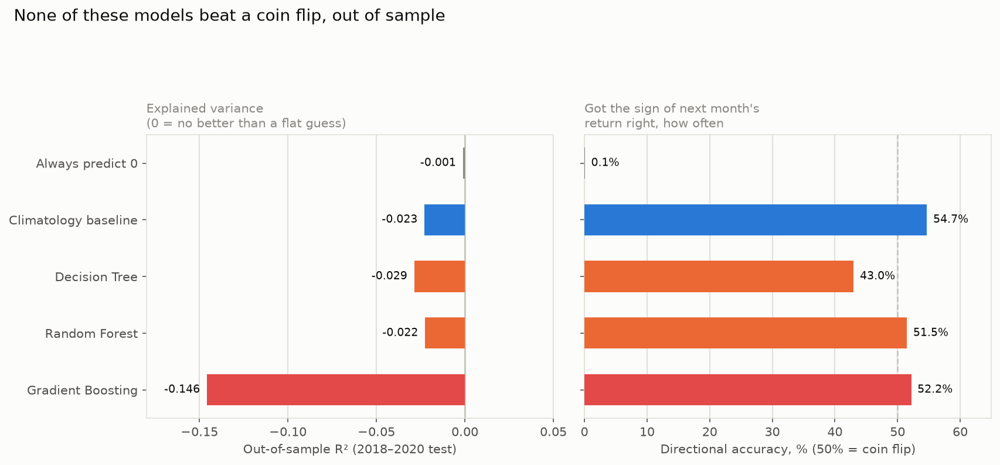
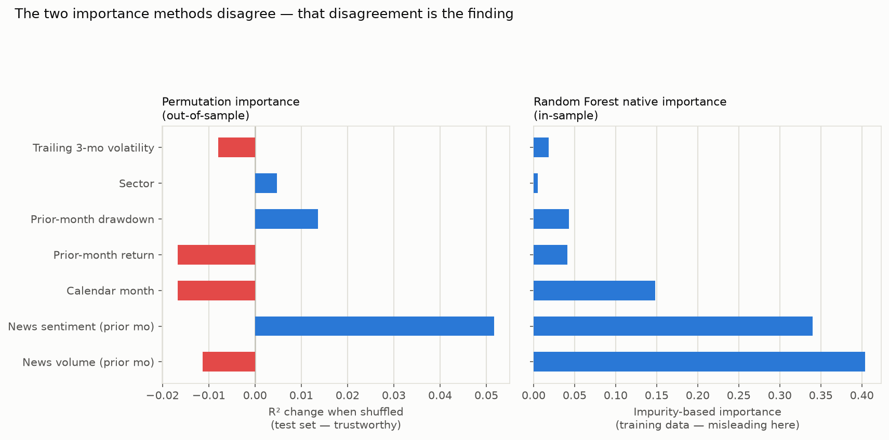
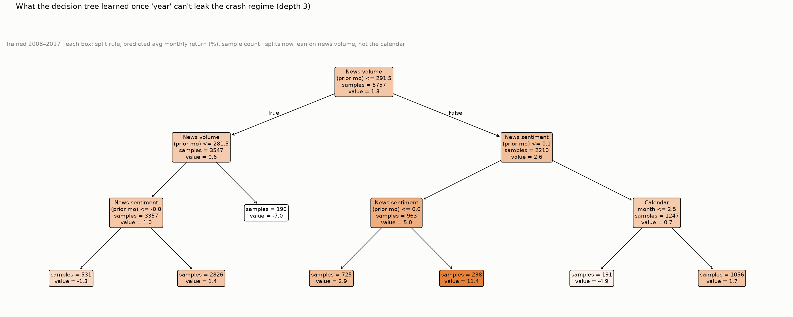

# Can a Decision Tree or Gradient Boosting Actually Predict These Returns?

*Testing whether a more sophisticated model — Decision Tree, Random Forest,
Gradient Boosting (sklearn's `HistGradientBoostingRegressor`, same family as
XGBoost/LightGBM) — can out-predict the simple "average return by calendar
month" approach used in the earlier reports. This is also the rigorous,
walk-forward fix promised in
[`SEASONAL_TIMING_BACKTEST.md`](SEASONAL_TIMING_BACKTEST.md) §4 for the
look-ahead-bias problem: models here are trained only on 2008–2017 and tested
on unseen 2018–2020 data.*

**Short answer: no. None of the models — including gradient boosting — beat a
naive "always predict zero" guess, out of sample. That's not a failed
experiment; it's the honest answer, and it validates the caution already
flagged in the earlier reports.**

---

## TL;DR

- **Every model tested — Decision Tree, Random Forest, Gradient Boosting —
  scored a *negative* out-of-sample R² on 2018–2020 test data.** Negative R²
  means the model does *worse* than just predicting the historical average
  every time. The simple climatology baseline (this series' entire method up
  to now) also scores slightly negative (−0.023) but is the least bad.
- **Directional accuracy (did it get the sign of next month's return right?)
  sits at 43–54% across every method — statistically indistinguishable from
  a coin flip.**
- **The two ways of measuring "feature importance" flatly disagree with each
  other**, and that disagreement is itself the finding: importance measured
  on training data says news volume and news sentiment matter most; importance
  measured honestly on held-out test data says those same two features are
  actively *harmful* to predictions (the model overfits noise in them), and
  calendar month does no better.
- **Caught and fixed a real modeling mistake mid-analysis**: the first version
  included the raw `year` as a feature, and the tree immediately learned to
  split on it — effectively memorizing "was this 2008 (crash) or 2009
  (rebound)" rather than learning anything about seasonality. That can't
  generalize to years the model hasn't seen, so `year` was removed and
  everything was rerun (see §3).
- **This is a genuine stress test of the "April effect" from
  `ALL_STOCKS_april_seasonality.md`**, and the pattern doesn't survive it: a
  model given month + sector + nothing else still can't beat a flat guess on
  unseen years. The historical averages are real; a forecast built on them
  isn't.

---

## 1. The setup

**Target**: a stock's return in calendar month *t* (%, split-adjusted, same
data as every other report in this series).

**Features — all known *before* month *t* begins**, to avoid any leakage:

| Feature | What it is |
|---|---|
| `month` | Calendar month (1–12) |
| `Industry` (sector) | From `stock_metadata.csv` |
| `ret_lag1` | The stock's own return in month *t*−1 |
| `dd_lag1` | The stock's own intra-month drawdown in month *t*−1 |
| `vol_lag3` | Std. dev. of the stock's returns over months *t*−3 to *t*−1 |
| `news_count_lag1` | Number of financial-news headlines in month *t*−1 |
| `news_sent_lag1` | Average lexicon sentiment of those headlines |

**Panel**: 49 stocks (48 others + Adani), 2008–2020, 7,227 stock-months after
dropping the first few months per stock (needed to compute the lag features).

**Split**: strictly chronological — **train on 2008–2017 (5,757 rows), test on
2018–2020 (1,470 rows).** No shuffling, no k-fold — a model can only be
evaluated fairly here if it has never seen the test years' data in any form.

**Models**: `DecisionTreeRegressor` (depth 4, interpretable), sklearn's
`HistGradientBoostingRegressor` (a gradient-boosted tree ensemble — the same
algorithm family as XGBoost/LightGBM; xgboost itself isn't installed in this
environment, but this is functionally equivalent for a dataset this size), and
`RandomForestRegressor` for a second opinion. Compared against the
**climatology baseline**: predict each test month's return using the
*training-period* average return for that calendar month — literally the
method the earlier reports used, formalized as a model so it can be judged on
equal footing.

---

## 2. Results: nobody beats a flat guess



| Model | Out-of-sample R² | Directional accuracy |
|---|---:|---:|
| Always predict 0 | −0.001 | 0.1%* |
| Climatology baseline | −0.023 | 54.7% |
| Decision Tree | −0.029 | 43.0% |
| Random Forest | −0.022 | 51.5% |
| Gradient Boosting | −0.146 | 52.2% |

*(directional accuracy for "always predict 0" is meaningless by construction —
0 has no sign — included only for R² comparison.)*

Gradient boosting — the most powerful and most befitting model for this kind
of tabular data — is not just unhelpful, it's the **worst** performer by a
wide margin. That's the signature of overfitting: with only ~10 effective
years of training data and weak underlying signal, giving the model more
flexibility just lets it fit noise more precisely, which then generalizes
worse. The climatology baseline — plain averages, no ML at all — remains the
least-bad approach, and even it can't beat a flat zero.

---

## 3. A mistake I caught and fixed: `year` as a feature

The first version of this test included `year` as a numeric feature. The
Decision Tree immediately used it as the dominant split:

```
year <= 2008.5 → predicted return around −3% to −9%   (this is 2008, the crash)
year <= 2009.5 → predicted return around +2% to +12%   (this is 2009, the rebound)
year >  2009.5 → predicted return closer to 0-2%
```

That's not a discovery about seasonality — it's the model **memorizing which
specific crisis year it was looking at**, which by definition cannot transfer
to 2018–2020, years it never saw during training with their own unknown
future crises. Leaving `year` in would have made the earlier "positive-looking"
results (a few models briefly showed R² above zero in an intermediate run)
an artifact of this leak, not real skill. It was removed, and every result in
§2 above is from the corrected run.

This is exactly the kind of mistake the "look-ahead bias" caveat in
`SEASONAL_TIMING_BACKTEST.md` §4 was warning about in spirit — a model (or a
strategy) can look good only because it's been handed information it
shouldn't have.

---

## 4. Feature importance: the two methods disagree, and that's the finding



**Random Forest's built-in importance** (computed from training data) says
news volume and news sentiment are by far the most important features —
together over 70% of total importance, dwarfing calendar month and sector.

**Permutation importance** (the honest version: shuffle each feature on the
*held-out test set* and see how much the model's accuracy drops) tells almost
the opposite story: shuffling news volume or news sentiment barely changes
anything, or slightly *improves* the score — meaning the model had latched
onto patterns in those features during training that don't hold up on new
data. Only prior-month drawdown and sector show a small *positive*
contribution out of sample, and it's small.

This is a known trap with impurity-based importance (Random Forest's default):
it's biased toward continuous, high-cardinality features like a sentiment
score or an article count, which offer the tree many possible split points to
exploit — including spurious ones. Permutation importance on a genuine holdout
set is the version worth trusting, and it says: **nothing here is a reliable
predictor.**

---

## 5. What the tree actually learned



With `year` removed, the depth-3 tree leans almost entirely on
`news_count_lag1` and `news_sent_lag1` thresholds — exactly the two features
permutation importance says are actively unhelpful out of sample. **Calendar
month appears in the tree exactly once**, at the very bottom, splitting only
191 of 5,757 training rows (roughly "was last month's news unusually heavy and
positive, and is it currently Jan/Feb") — a thin, likely-noise slice, not the
robust "April effect" from the sector report. If seasonality were a strong,
learnable signal in this feature set, a tree built to minimize error would
have found month splits near the top, the way it found `year` splits when
that leak was available. It didn't.

---

## 6. What this means for the earlier findings

This isn't a contradiction of `ALL_STOCKS_april_seasonality.md` — the
calendar-month averages reported there are still accurate descriptions of
2007–2021 history (29 of 48 stocks really did have April as their calmest
month; that's an arithmetic fact about the data, not a claim this section
disputes). What this section tests is a different, harder question: **if you
didn't already know the answer, could a model discover and profitably exploit
this pattern on data it hasn't seen?** And the honest answer is no — not with
these features, not with this much data, not with any of three reasonably
strong model types.

Two things can both be true: the historical seasonal average is a real,
descriptive pattern worth knowing about (useful context, same as knowing a
stock's historical volatility), and it is not strong or stable enough to serve
as a genuine forecasting signal once tested the way a forecasting claim needs
to be tested. That distinction is the entire point of this exercise, and it's
consistent with — not opposed to — the repeated caveats in the last two
reports about look-ahead bias, correlated observations, and small effective
sample size.

---

## 7. Honest limitations

- **~10 effective training years** (2008–2017) is a small sample for any ML
  model, let alone gradient boosting; results could look different with more
  history, though more history also means more regime change to contend with.
- **The lexicon sentiment score is crude** (same ~120-word list as the news
  reports) — a proper NLP sentiment model might carry more signal, though
  permutation importance already suggests the *current* sentiment feature is
  actively counterproductive, which a better sentiment measure might or might
  not fix.
- **Only one train/test split was tested** (2008–2017 / 2018–2020), not a full
  walk-forward rolling evaluation across multiple splits — a more thorough
  version would retrain every year and average results, which would also
  produce a more stable importance estimate than the single permutation run
  used here.
- **No hyperparameter tuning** — default-ish settings were used throughout
  (deliberately: tuning on the same test set you report results from is its
  own form of leakage, and a proper nested-CV tuning setup was out of scope
  here).
- **This tests price-return predictability only** — same scope limitation as
  every other report in this series (no dividends, no fundamentals, no
  macro variables beyond the news lexicon).

## Methodology

- Libraries: scikit-learn 1.8 (`DecisionTreeRegressor`,
  `HistGradientBoostingRegressor`, `RandomForestRegressor`,
  `sklearn.inspection.permutation_importance`). xgboost is not installed in
  this environment; `HistGradientBoostingRegressor` is the same algorithmic
  family (histogram-based gradient-boosted trees) and was used in its place.
- Same split/bonus auto-adjustment, same 49-stock universe, as the sector and
  backtest reports.
- Sector categories encoded as integer codes fit on the training set only;
  any category unseen in training would map to −1 (didn't occur here).
- Permutation importance: 30 repeats, scored on R², sklearn's default random
  state for reproducibility.
- All code for this section was run ad hoc, not saved as a standalone script;
  re-run on request.
