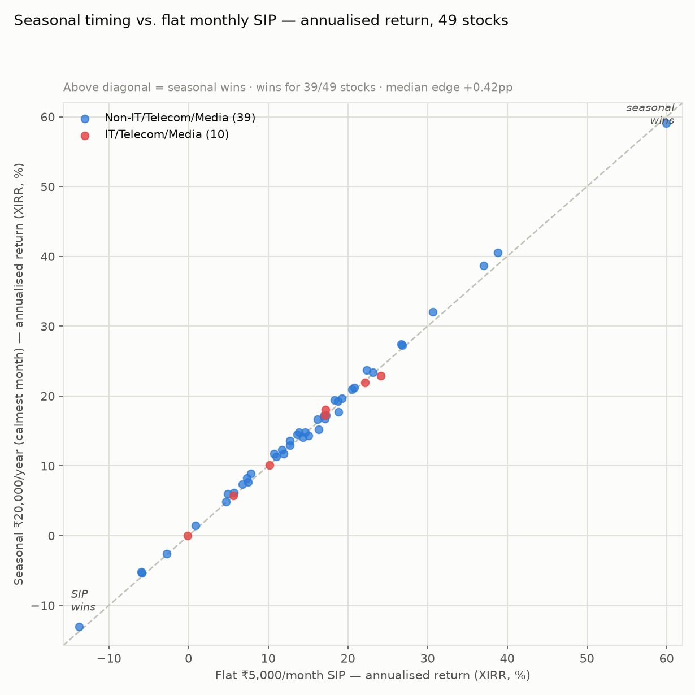
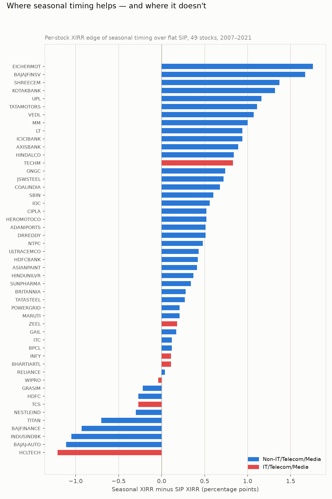
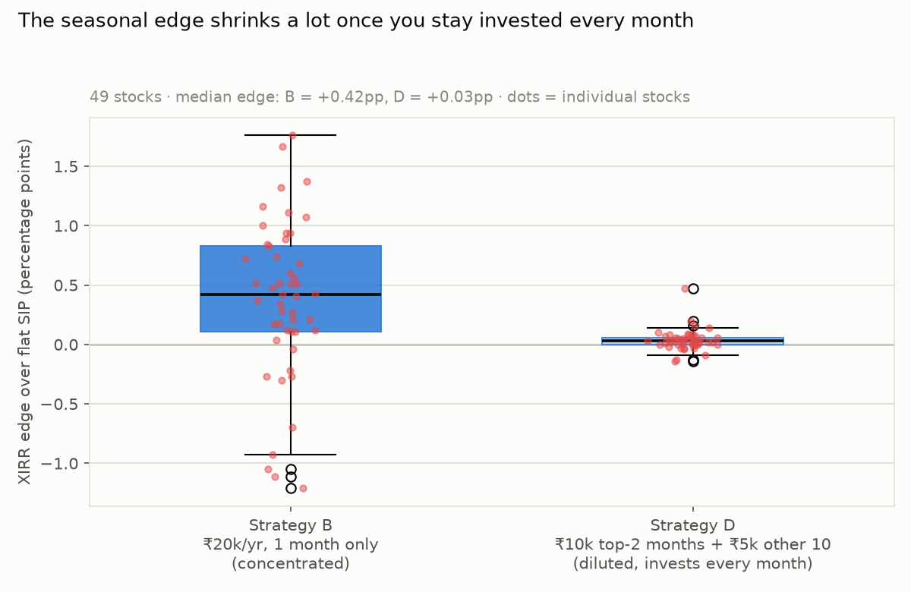
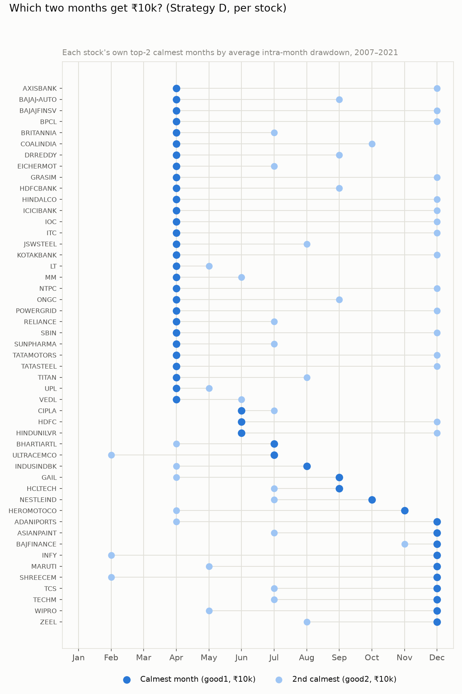
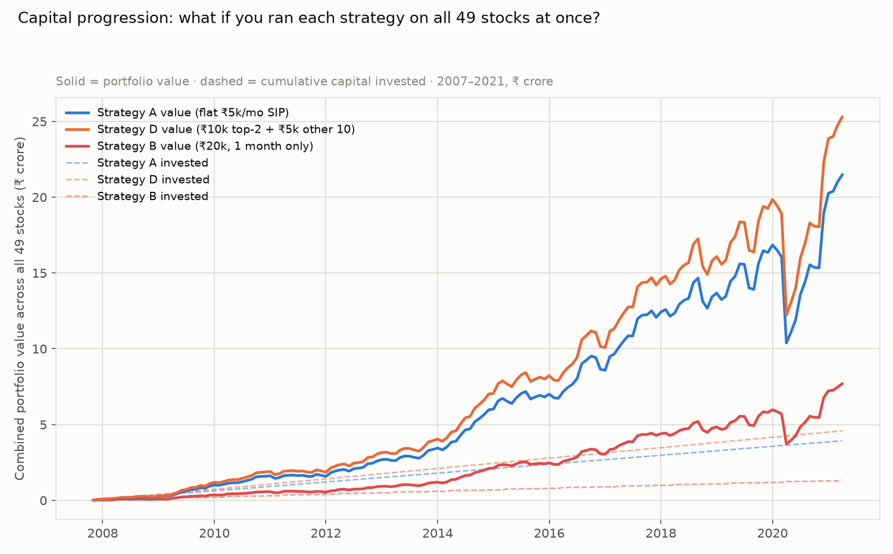

# Does Seasonal Timing Actually Beat a Flat SIP?

*Testing the idea straight from the last report: instead of ₹5,000 every month,
put ₹20,000 once a year into each stock's own historically calmest month
(April for most sectors, September/December for IT — see
[`ALL_STOCKS_april_seasonality.md`](ALL_STOCKS_april_seasonality.md)). Backtested
on all 49 stocks, 2007–2021, using proper XIRR so the "percentage" comparison is
apples-to-apples regardless of how much cash each strategy deploys.*

**Short answer: yes, slightly, for most stocks — but the edge is small (median
+0.42 percentage points of annualised return), and there's one important
look-ahead-bias caveat below that an honest reader needs before trusting the
number.**

---

## TL;DR

- **Seasonal timing wins on annualised return (XIRR) for 39 of 49 stocks (80%).**
  Mean XIRR: 14.7% (flat SIP) vs 15.1% (seasonal). Median edge: **+0.42
  percentage points a year.**
- The edge is **real but modest** — nobody should expect this to turn a mediocre
  stock into a great one. It nudges good outcomes slightly better, most of the
  time.
- **It deploys far less capital.** ₹20,000/year (single month) is ~₹2.8 lakh
  over 14 years, against ₹8.4 lakh for the ₹5,000/month SIP — a **3× difference
  in money actually put to work.** The XIRR comparison is fair *for the
  percentage return question you asked*, but if the goal is building the
  largest pot of money, the flat SIP still wins for most people simply because
  it invests three times as much.
- **Testing "Sept AND Dec for IT" specifically** (₹10k each, both months) does
  *not* beat using IT's single calmest month, and neither clearly beats flat
  SIP for IT stocks — consistent with the earlier finding that IT doesn't carry
  much of a seasonal effect at all.
- **The most important caveat**: this backtest picks each stock's "calmest
  month" using its *entire* 2007–2021 history — including years an investor in,
  say, 2009 couldn't have seen yet. That's look-ahead bias. See §4.
- **Follow-up (§6): if you stay invested every month and just tilt the
  weighting** (₹10k in the top-2 calmest months, ₹5k in the other 10 — much
  closer to the SIP's total capital) **the edge collapses to +0.03pp median —
  essentially nothing.** Most of Strategy B's edge came from concentrating into
  one month and skipping the other 11, not from the calendar itself.

---

## 1. The two strategies, head to head

- **Strategy A (flat SIP)**: ₹5,000 on the first trading day of every month,
  every month, 2007–2021 — what the Adani report originally tested.
- **Strategy B (seasonal)**: ₹20,000 once a year, on the first trading day of
  that stock's single historically-calmest month (by lowest average
  intra-month drawdown — the same metric from the sector report).

Both use the same split-adjusted prices and end on the same date (30 Apr 2021),
so returns are directly comparable in percentage terms.

Most points sit very close to the diagonal — the two strategies produce similar
annualised returns for most stocks, with seasonal timing nudged slightly higher
more often than not.

---

## 2. Where it helps, where it doesn't

| Symbol | Best month used | SIP XIRR | Seasonal XIRR | Edge (pp) | SIP multiple | Seasonal multiple |
|---|---|---:|---:|---:|---:|---:|
| EICHERMOT | Apr | 38.82% | 40.58% | +1.76 | 18.95x | 21.17x |
| BAJAJFINSV | Apr | 37.05% | 38.71% | +1.67 | 14.62x | 14.18x |
| SHREECEM | Dec | 30.67% | 32.04% | +1.37 | 10.08x | 12.01x |
| KOTAKBANK | Apr | 22.38% | 23.70% | +1.32 | 5.28x | 5.72x |
| UPL | Apr | 18.31% | 19.46% | +1.16 | 3.85x | 4.12x |
| TATAMOTORS | Apr | 7.83% | 8.94% | +1.11 | 1.74x | 1.86x |
| VEDL | Apr | 4.90% | 5.98% | +1.07 | 1.41x | 1.51x |
| MM (Mahindra) | Apr | 10.74% | 11.74% | +1.00 | 2.16x | 2.29x |
| ICICIBANK | Apr | 13.85% | 14.78% | +0.94 | 2.73x | 2.88x |
| LT | Apr | 7.32% | 8.25% | +0.94 | 1.68x | 1.77x |
| AXISBANK | Apr | 12.74% | 13.63% | +0.89 | 2.51x | 2.64x |
| HINDALCO | Apr | 13.67% | 14.51% | +0.84 | 2.70x | 2.82x |
| TECHM | Dec | 17.18% | 18.02% | +0.83 | 3.53x | 3.89x |
| ONGC | Apr | −5.92% | −5.19% | +0.74 | 0.68x | 0.72x |
| JSWSTEEL | Apr | 26.70% | 27.42% | +0.72 | 7.39x | 7.64x |
| COALINDIA | Apr | −13.72% | −13.04% | +0.68 | 0.51x | 0.54x |
| SBIN | Apr | 6.80% | 7.40% | +0.60 | 1.61x | 1.67x |
| IOC | Apr | 0.87% | 1.43% | +0.56 | 1.06x | 1.10x |
| CIPLA | Jun | 11.75% | 12.27% | +0.52 | 2.33x | 2.44x |
| HEROMOTOCO | Nov | 5.67% | 6.19% | +0.52 | 1.49x | 1.57x |
| ADANIPORTS | Dec | 18.73% | 19.25% | +0.51 | 3.98x | 4.29x |
| DRREDDY | Apr | 16.18% | 16.69% | +0.51 | 3.27x | 3.33x |
| NTPC | Apr | −5.84% | −5.37% | +0.48 | 0.68x | 0.71x |
| ULTRACEMCO | Jul | 19.24% | 19.67% | +0.43 | 4.14x | 4.24x |
| HDFCBANK | Apr | 20.52% | 20.94% | +0.42 | 4.57x | 4.62x |
| ASIANPAINT | Dec | 26.86% | 27.27% | +0.41 | 7.49x | 8.18x |
| HINDUNILVR | Jun | 20.79% | 21.17% | +0.37 | 4.67x | 4.83x |
| SUNPHARMA | Apr | 11.02% | 11.36% | +0.34 | 2.21x | 2.23x |
| BRITANNIA | Apr | 23.15% | 23.43% | +0.28 | 5.61x | 5.60x |
| TATASTEEL | Apr | 12.69% | 12.96% | +0.27 | 2.50x | 2.51x |
| MARUTI | Dec | 16.97% | 17.18% | +0.21 | 3.47x | 3.64x |
| POWERGRID | Apr | 7.49% | 7.69% | +0.21 | 1.70x | 1.70x |
| ZEEL | Dec | −0.14% | 0.04% | +0.18 | 0.99x | 1.00x |
| GAIL | Sep | −2.74% | −2.57% | +0.17 | 0.83x | 0.84x |
| ITC | Apr | 4.74% | 4.86% | +0.12 | 1.39x | 1.39x |
| BPCL | Apr | 14.67% | 14.79% | +0.12 | 2.91x | 2.88x |
| INFY | Dec | 17.11% | 17.22% | +0.11 | 3.51x | 3.66x |
| BHARTIARTL | Jul | 5.65% | 5.75% | +0.11 | 1.49x | 1.50x |
| RELIANCE | Apr | 17.23% | 17.27% | +0.04 | 3.54x | 3.48x |
| WIPRO | Dec | 10.16% | 10.11% | −0.04 | 2.07x | 2.10x |
| GRASIM | Apr | 11.92% | 11.70% | −0.22 | 2.36x | 2.28x |
| TCS | Dec | 22.19% | 21.92% | −0.27 | 5.20x | 5.32x |
| HDFC | Jun | 14.38% | 14.11% | −0.27 | 2.85x | 2.81x |
| NESTLEIND | Oct | 17.09% | 16.79% | −0.30 | 2.80x | 2.67x |
| TITAN | Apr | 15.05% | 14.35% | −0.70 | 2.99x | 2.79x |
| BAJFINANCE | Dec | 59.98% | 59.06% | −0.93 | 91.20x | 97.23x |
| INDUSINDBK | Aug | 18.82% | 17.76% | −1.05 | 4.00x | 3.61x |
| BAJAJ-AUTO | Apr | 16.34% | 15.23% | −1.11 | 3.15x | 2.72x |
| HCLTECH | Sep | 24.15% | 22.94% | −1.21 | 6.06x | 5.26x |

Two things jump out:

1. **The stocks where seasonal timing helps most (Eicher Motors, Bajaj Finserv,
   Shree Cement, Kotak Bank) are the same kind of domestic-cyclical names**
   that showed the strongest April effect in the sector report.
2. **The stocks where it hurts most are mostly IT** (HCL Tech, and note that
   despite using their own correct calmest month, TCS and Wipro also come out
   negative or flat) **plus a cluster of high-growth compounders** (Bajaj
   Finance, Titan, Bajaj Auto, IndusInd Bank) where the stock spent so much of
   2007–2021 in a strong, low-volatility uptrend that spreading purchases
   across all 12 months captured the compounding just as well — sometimes
   better — than concentrating into one.

---

## 3. Testing "Sept AND Dec for IT" specifically

You mentioned IT should get two months. Splitting ₹20,000 evenly across
September and December each year, instead of picking just one:

| Symbol | Flat SIP (A) | Single best month (B) | Sept+Dec split (C) |
|---|---:|---:|---:|
| INFY | 17.11% | 17.22% (Dec) | 17.17% |
| TCS | 22.19% | 21.92% (Dec) | 21.69% |
| WIPRO | 10.16% | 10.11% (Dec) | 10.20% |
| TECHM | 17.18% | 18.02% (Dec) | 17.12% |
| HCLTECH | 24.15% | 22.94% (Sep) | 23.56% |

Splitting across two months doesn't clearly beat either alternative — it lands
in between, within noise, for every IT name. This matches what the sector
report already found: **IT genuinely doesn't have a reliable seasonal edge**,
so no version of "pick the right IT month(s)" does much for these five stocks.

---

## 4. The caveat that matters most: look-ahead bias

Every "calmest month" used above (April for most stocks, December for Adani/
IT-majority, etc.) was chosen by **looking at that stock's entire 2007–2021
history and picking the best month in hindsight.** An investor actually
standing in, say, January 2009 did not have 2010–2021 data to know April would
turn out to be the calmest month for ICICI Bank.

This doesn't mean the finding is fake — the underlying *cause* (India's fiscal
year starting April 1, RBI's scheduled April policy review, Q4 results timing)
existed the whole time and would have been visible reasonably early. But the
backtest as run is **not** a faithful simulation of "what would a real investor
have done starting from zero information." A more rigorous version would pick
each year's target month using only *prior* years' data (walk-forward, not
whole-sample) — that's a natural next step if this is going to inform real
money, and it would very likely show a smaller edge than the one above, since
some of what's being captured here is the backtest "knowing" the answer early.

---

## 5. Other honest limitations

- **No dividends, no STT, no brokerage, no capital-gains tax** in either
  strategy — same omission as every other report in this series.
- **Capital deployed differs 3×** between strategies (₹2.8L vs ₹8.4L over 14
  years) — XIRR is the right tool to compare *rates*, but don't read this as
  "seasonal timing builds more wealth." In absolute rupees, the flat SIP still
  usually ends with a bigger pot because it puts in three times as much
  capital. If you want to compare *wealth built*, scale Strategy B up to match
  Strategy A's annual outlay (e.g. ₹60,000 once a year in the best month) and
  re-run — happy to do that next if useful.
- **This corrects a methodology gap in the earlier Adani report.** That
  report's SIP "annualised return" (10.77%) used a rough
  multiple^(1/years)-1 approximation. Proper XIRR on the same cash flows gives
  **18.73%** — noticeably higher, because XIRR correctly accounts for later
  contributions having less time to compound. The multiple (3.98×) and total
  values in that report are still correct; only that one annualised-%% figure
  was an underestimate.
- **Split/bonus adjustment is automated** (see the sector report's
  methodology) — spot-checked, not hand-verified for all 49 stocks.
- **One 13.4-year window** containing one global financial crisis and one
  pandemic crash. Results would differ in a different period.

---

## 6. Your follow-up: what if you stay invested every month, just tilted?

Strategy B above only buys in *one* month a year — it skips the other 11
entirely, which is why it only deploys ⅓ of the SIP's capital (§2 flagged this
as a fairness problem). Your fix: **keep investing every month like a normal
SIP, just put more into the good ones** — ₹10,000 in each stock's top-2
calmest months, ₹5,000 in the other 10. Call this **Strategy D.**

This also fixes the capital mismatch almost entirely: ₹10k×2 + ₹5k×10 =
₹70,000/year, only ~17% more than the flat SIP's ₹60,000/year (vs. Strategy
B's ₹20,000/year, which was 3× *less*). Same 49 stocks, same 2007–2021 window,
same XIRR method.

**The edge nearly disappears.**

| | Strategy B (concentrated, 1 month, ₹20k/yr) | Strategy D (diluted, every month, ₹10k/₹5k) |
|---|---:|---:|
| Beats flat SIP | 39 / 49 stocks (80%) | 34 / 49 stocks (69%) |
| Median XIRR edge | **+0.42 pp** | **+0.03 pp** |
| Mean XIRR edge | +0.38 pp | +0.04 pp |
| Avg. capital deployed vs. SIP | 0.35× (much less) | 1.17× (close to parity) |

Going from "only buy in the best month" to "buy every month but tilt the
weighting" takes the median annualised edge from **+0.42 points down to +0.03
points** — essentially noise. A few stocks (Bajaj Finserv +0.47pp, Tata Motors
+0.20pp) still show a small real benefit; several others (Bajaj Finance,
HCL Tech, Britannia) flip slightly negative.

**Why this happens**: Strategy B's apparent edge in §2 was doing two things at
once — (1) tilting toward historically calmer/stronger months, and (2)
*skipping* 11 months of ordinary DCA entirely, which happens to be a
concentration bet that paid off *in this specific 2007–2021 sample* partly
by chance of when the big compounding stretches fell. Once you stop skipping
months and just nudge the weights (Strategy D), effect (2) goes away and
you're left with only effect (1) — which, on its own, is worth barely anything.
**Most of what looked like a "seasonal alpha" in §2 was really a concentration
effect, not a seasonality effect.**

That's a more honest and more useful answer than either extreme: seasonal
*tilting* while staying fully invested every month is safe to do (it doesn't
hurt, and it's what a disciplined SIP investor could actually implement without
timing risk) — but don't expect it to move your returns much. If the goal was
a meaningfully better number, Strategy B's concentration is doing the work, not
the calendar.

## 7. Which stocks, which months, and what the money looks like over time

**Which months get the ₹10k in Strategy D**, per stock (top-2 calmest months,
same data behind §6):

April dominates as the "calmest" pick, exactly as the sector report found;
December is the most common runner-up, including for most of the IT names
(Infosys, TCS, Wipro, Tech Mahindra all pair a mid-year month with December).
A handful of stocks — HDFC Life-adjacent financials, cement names, ONGC — pick
unusual pairs (Coal India: Apr+Oct; Nestlé: Jul+Oct; Ultratech: Feb+Jul) simply
because that's what their own 2007–2021 history says was calmest; nothing here
is hand-picked by sector, it's each stock's own number.

**Capital progression** — running each strategy on all 49 stocks at once (every
stock gets its own SIP/tilt/concentration bet simultaneously), summed into one
combined portfolio:

Final numbers, 2007–2021, all 49 stocks combined:

| Strategy | Total invested | Final value | Multiple |
|---|---:|---:|---:|
| A — flat ₹5k/month SIP | ₹3.93 crore | ₹21.47 crore | 5.46× |
| D — ₹10k top-2 months + ₹5k other 10 | ₹4.59 crore | ₹25.29 crore | 5.50× |
| B — ₹20k, one month only | ₹1.34 crore | ₹7.69 crore | 5.74× |

This is the same §6 finding, just visible as money instead of percentages: D's
orange line tracks consistently a little above A's blue line for the entire
14 years — the gap is real but it never dramatically pulls away, which is what
a +0.03pp median XIRR edge looks like when compounded. All three strategies
fall together in the 2020 COVID crash and recover together, because they're
holding the same 49 stocks — timing didn't buy any crash protection.

*(Note: an earlier draft of this chart had a visible glitch — a stray dip
around Jan 2010 — caused by one stock's first trading day of a given month
landing on a different calendar date than the other 48 and fragmenting the
monthly aggregation. Fixed by grouping strictly by (year, month) before
summing; flagging it here since catching your own bugs is part of the
methodology, not just the results.)*

## Methodology

- Same split/bonus auto-adjustment as the sector report.
- Each stock's "calmest month" recomputed fresh here (average intra-month
  drawdown, 2007–2021) for full consistency with this specific backtest.
- **XIRR** computed properly via Newton/Brent root-finding on the actual dated
  cash flows (all contributions as negative flows, final portfolio value as one
  positive flow on 30 Apr 2021) — not the simplified approximation used in the
  original Adani SIP figure.
- Final portfolio value = total units purchased × last available split-adjusted
  close (30 Apr 2021).
- Full per-stock results: `seasonality_charts/` holds the charts; raw numbers
  are the table in §2.
- **Strategy D** (§6): "good months" = each stock's own top-2 calmest months
  by average intra-month drawdown (not a fixed April/Dec rule — recomputed
  per stock, shown in the underlying results file). ₹10,000 invested in those
  two months each year, ₹5,000 in the other ten, every year, same window and
  final-value method as Strategies A and B.
