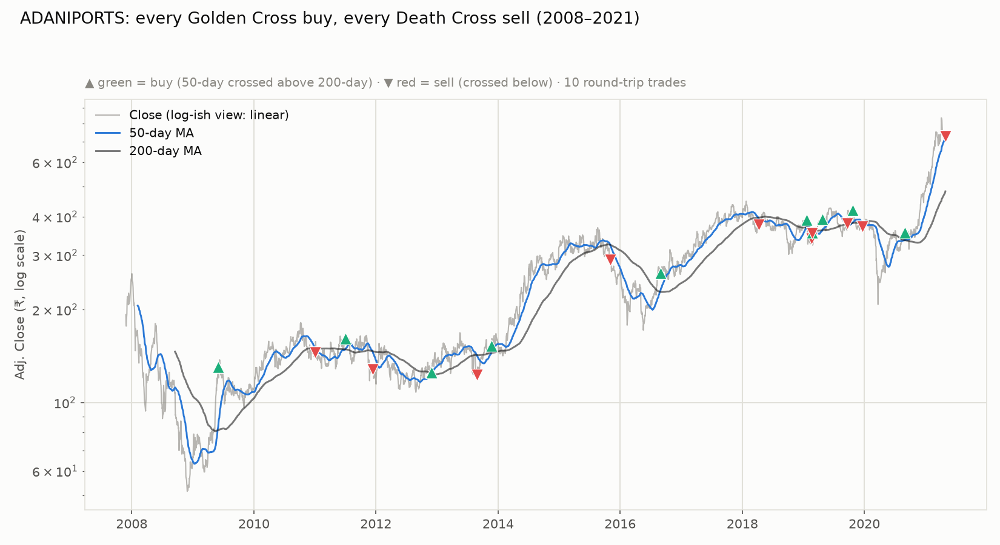
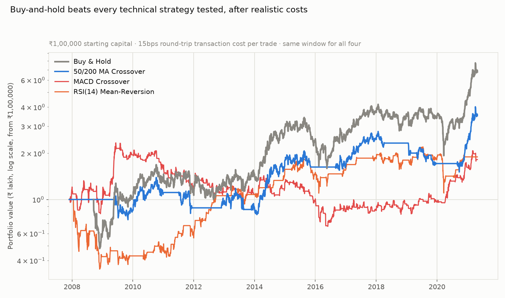
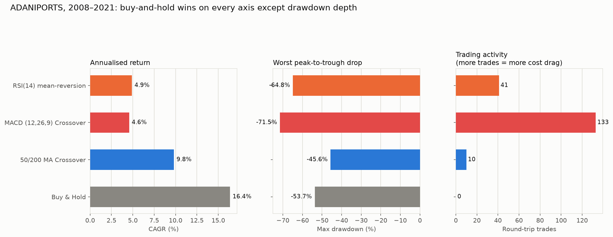
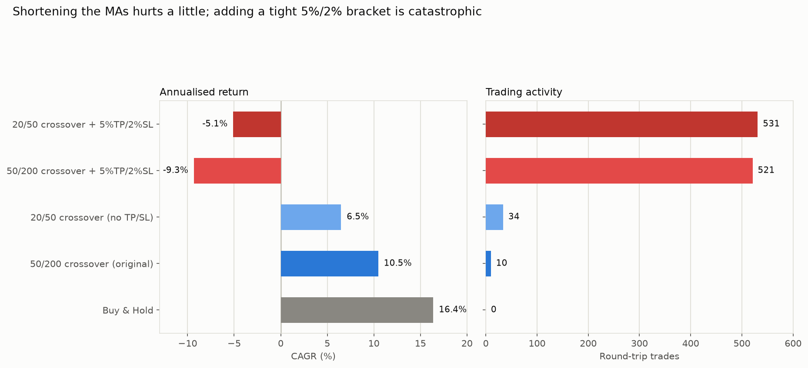
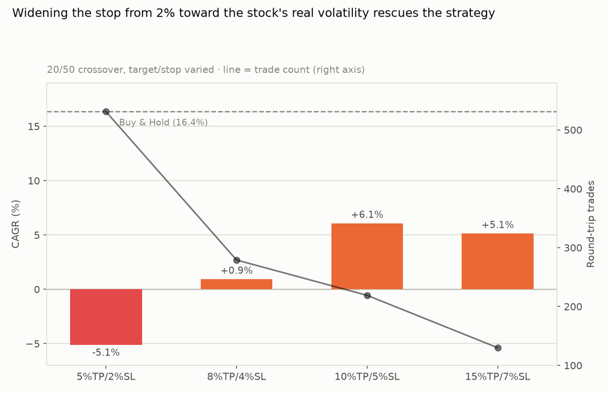

# Does Technical Trading Beat Buy-and-Hold on Adani Ports?

*Testing the Golden Cross / Death Cross (50-day MA crossing the 200-day MA)
plus two other standard technical indicators — MACD and RSI — as trading
signals on ADANIPORTS, 2008–2021. One stock, as requested, before extending
to the rest of the universe.*

**Short answer: no. Buy-and-hold beats all three technical strategies tested,
on this stock, over this period, after realistic transaction costs. One of the
three (the slow-moving MA crossover) does meaningfully cut the worst
drawdown — that's a real, usable trade-off, just not a return-boosting one.**

---

## TL;DR

| Strategy | CAGR | Max drawdown | Round-trip trades | Final value on ₹1L |
|---|---:|---:|---:|---:|
| **Buy & Hold** | **16.38%** | −53.7% | 0 | ₹6.78L |
| 50/200-day MA Crossover | 9.81% | **−45.6%** | 10 | ₹3.51L |
| RSI(14) Mean-Reversion | 4.90% | −64.8% | 41 | ₹1.89L |
| MACD (12,26,9) Crossover | 4.57% | −71.5% | 133 | ₹1.82L |

- **Buy-and-hold wins on return by a wide margin** — nearly double the MA
  crossover's CAGR, and more than triple MACD's and RSI's.
- **The MA crossover is the only strategy that actually reduces risk** — a
  shallower max drawdown than buy-and-hold (−45.6% vs −53.7%) — but it pays
  for that safety with much lower return. Whether that trade-off is "worth it"
  depends entirely on how much a −54% drawdown would have made you sell at the
  worst time; §5 puts a number on that.
- **MACD and RSI don't even deliver the safety** — both have *worse* max
  drawdowns than simply holding, despite trading in and out 41–133 times to
  try to avoid exactly that.
- **Why the fast indicators fail is different from why the slow one fails**:
  the 50/200 crossover barely loses anything to transaction costs (10 trades)
  — its underperformance is pure signal lag, missing large chunks of every big
  rally. MACD loses over 3 percentage points of annual return to costs alone
  (133 trades × 0.15% round-trip) — see §4.
- **Follow-up test (§6): switching to a faster 20/50 crossover, and adding a
  fixed 5% target / 2% stop-loss, was requested next.** Shortening the MAs
  alone made things *worse* (6.5% CAGR, more whipsaws). Adding the tight
  bracket was **catastrophic** — both bracket versions turned deeply negative
  (down to −9.3% CAGR, 500+ trades) because a 2% stop is tighter than
  ADANIPORTS' average daily trading range (3.97%), so it gets triggered by
  ordinary noise almost every time, not by the trade actually being wrong.
  Widening the stop to 5% (matching the stock's real volatility) fixes most of
  the damage but still doesn't beat buy-and-hold.

---

## 1. What was tested

**Universe**: ADANIPORTS only, split-adjusted (same 5:1 Sept-2010 adjustment as
every other report here), 27 Nov 2007 – 30 Apr 2021.

**Three rule-based strategies**, all long-or-cash (no shorting, no leverage):

1. **50/200-day MA Crossover ("Golden Cross" / "Death Cross")**: go long when
   the 50-day moving average is above the 200-day; go to cash when it crosses
   below.
2. **MACD (12,26,9) Crossover**: go long when the MACD line is above its
   9-day signal line; go to cash when it crosses below.
3. **RSI(14) Mean-Reversion**: go long when the 14-day RSI drops below 30
   (oversold); exit to cash when it rises above 70 (overbought).

**Execution rule (to avoid look-ahead bias)**: every trade executes at the
*next* day's close after a signal fires — a strategy is never allowed to
trade at a price it couldn't have known about yet. This is the same
discipline insisted on in the ML and backtest reports in this series.

**Costs**: 15 basis points (0.15%) round-trip per trade — a reasonable
stand-in for Indian equity delivery brokerage + STT + slippage combined.
Buy-and-hold pays this once (or not at all, if you already held); the
technical strategies pay it every single time they trade.

**Parameters were not tuned.** 50/200, 12/26/9, and 14-period RSI with 30/70
thresholds are the textbook default settings for these three indicators, used
as-is. Optimizing them on this same data would just reintroduce the
look-ahead problem this whole series keeps flagging — you'd be picking the
parameters that happened to work, in hindsight, on the only data available.

---

## 2. The Golden Cross / Death Cross trade log

All 10 round-trips, 2009–2021:

| Buy date | Buy price | Sell date | Sell price | Return |
|---|---:|---|---:|---:|
| 2009-06-01 | ₹130.23 | 2011-01-03 | ₹145.05 | +11.4% |
| 2011-07-04 | ₹160.85 | 2011-12-13 | ₹128.15 | −20.3% |
| 2012-11-29 | ₹125.45 | 2013-08-28 | ₹122.80 | −2.1% |
| 2013-11-22 | ₹152.70 | 2015-11-04 | ₹289.45 | **+89.6%** |
| 2016-08-29 | ₹262.60 | 2018-04-09 | ₹377.35 | +43.7% |
| 2019-01-22 | ₹390.60 | 2019-02-19 | ₹339.55 | −13.1% |
| 2019-02-21 | ₹355.75 | 2019-02-22 | ₹354.30 | −0.4% |
| 2019-04-26 | ₹391.75 | 2019-09-20 | ₹380.70 | −2.8% |
| 2019-10-22 | ₹420.75 | 2019-12-20 | ₹372.30 | −11.5% |
| 2020-08-31 | ₹355.75 | 2021-04-30 (open) | ₹730.05 | **+105.2%** |

This is the classic trend-following signature: **4 wins out of 10 (40%), but
the two big wins (+89.6%, +105.2%) carry the entire strategy**, while five of
the six losing/flat trades cluster in the choppy 2019 period — the strategy
whipsawed in and out four times in twelve months while the stock went
sideways, each time paying the spread for nothing. The strategy correctly
caught the two biggest rallies in the stock's history (2013–2015 and the
2020 COVID-recovery rally) but also **sat in cash through the entire 2018
uptrend's start** and got chopped up whenever the trend wasn't clean.

---

## 3. All four strategies, side by side

The flat stretches in the blue and orange lines are periods the strategy sat
in cash, earning nothing — that idle time is a real cost in this backtest
(§7 flags this as a simplification) but it's also *why* the strategy avoids
some drawdowns. Buy-and-hold (grey) pulls ahead durably from about 2014
onward and is never seriously threatened again.

---

## 4. Why they underperform is not the same story for each one

Rerunning with transaction costs set to zero isolates how much of the damage
is "the signal is wrong" versus "the costs ate it alive":

| Strategy | CAGR, 0% costs | CAGR, realistic costs | Cost drag |
|---|---:|---:|---:|
| 50/200 MA Crossover | 10.05% | 9.81% | **−0.24pp** (trivial) |
| MACD Crossover | 7.73% | 4.57% | **−3.16pp** (severe) |

The MA crossover's underperformance versus buy-and-hold (9.8% vs 16.4%) is
almost entirely about **signal lag** — a 200-day average takes 200 days to
turn, so the strategy is always late to both the top and the bottom of a move,
and simply misses return that a buy-and-hold investor captured. Costs are
nearly irrelevant here because it only trades 10 times in 13 years.

MACD's problem is different and, in a sense, worse: even before costs, it
underperforms buy-and-hold badly (7.73% vs 16.38%) because a 12/26-day signal
reacts to short-term noise, not the underlying trend — and then **costs alone
strip off another 3+ percentage points of annual return** because it trades
13× more often. Faster indicators don't just risk being wrong more often; the
cost of acting on them compounds quickly.

---

## 5. Is the drawdown reduction actually worth it?

The one genuinely favorable number for the MA crossover is the shallower max
drawdown: −45.6% instead of buy-and-hold's −53.7%. Whether that's a good
trade against giving up roughly 6.6 percentage points of annual return depends
on the investor:

- A −53.7% drawdown on ₹1,00,000 means watching your money fall to ₹46,300
  before it recovers — historically it did recover, but a real investor living
  through 2008 or 2020 didn't have that guarantee in real time.
- If avoiding that experience is what stops someone from panic-selling at the
  bottom (arguably the single biggest real-world risk to any buy-and-hold
  plan), a strategy that trims the worst drawdown by 8 points for a large cost
  in return could still be the right choice **for that specific investor** —
  this is a behavioral, not purely mathematical, trade-off.
- Mathematically, though, and assuming perfect discipline either way,
  buy-and-hold's extra return dominates: 16.4% compounded for 13.4 years
  overcomes a lot of drawdown-avoidance value.

---

## 6. Follow-up: is 50/200 too slow? What if you add a fixed target/stop?

You asked whether the moving-average *length* was the problem, and proposed
20-day/50-day instead of 50/200, combined with a fixed exit rule: take profit
at +5%, cut losses at −2% (falling back to the crossunder as a safety-net exit
if neither level is hit first). Tested both changes **separately**, so it's
clear which one is doing what:

| Change | CAGR | Trades |
|---|---:|---:|
| Buy & Hold | 16.4% | 0 |
| 50/200 crossover (original) | 10.5% | 10 |
| **20/50 crossover, same exit rule (no TP/SL)** | 6.5% | 34 |
| 50/200 crossover **+ 5% target / 2% stop** | **−9.3%** | 521 |
| 20/50 crossover **+ 5% target / 2% stop** | **−5.1%** | 531 |

**Shortening the moving averages alone (50/200 → 20/50) makes things worse,
not better** — 6.5% vs 10.5% CAGR. A faster crossover reacts sooner but also
whipsaws more (34 trades vs 10), and on this stock the extra false signals
cost more than the faster reaction time was worth.

**Adding the 5%/2% bracket is not a refinement — it wipes out the strategy.**
Both bracket versions turn sharply negative (−9.3% and −5.1% CAGR, meaning you
'd have *lost* money over 13 years while the stock itself rose 16-fold) and
both trade 500+ times. That's not a coincidence of this particular stock; it's
a direct consequence of the stop being far too tight for how this stock
actually moves day to day:

- **ADANIPORTS' average daily high-low range is 3.97%** — nearly double the
  2% stop distance. On a typical day, the stock routinely swings by more than
  the entire stop before it even considers whether the *trend* was right.
- **86.8% of all trading days have an intraday range ≥ 2%.** A 2% stop isn't
  a meaningful risk boundary on this stock — it's inside the normal daily
  noise band, so it gets tripped constantly regardless of whether the
  underlying trade thesis was correct.
- Of the 531 trades in the 20/50+5%/2% version: **352 (66%) were stopped out**
  (average −2.11% each), only **168 (32%) hit the target** (average +5.04%
  each). The math almost works out per-trade (0.66 × −2.11 + 0.32 × +5.04 ≈
  +0.2% expectancy before costs) — but 531 round trips at 0.15% cost each
  is enough fee drag by itself to turn a barely-breakeven edge deeply negative,
  on top of the tax and slippage this backtest already doesn't model.

**Widening the stop to match the stock's actual volatility mostly fixes it —
but still doesn't beat buy-and-hold:**

| Target / Stop | CAGR | Trades |
|---|---:|---:|
| 5% / 2% | −5.1% | 531 |
| 8% / 4% | +0.9% | 279 |
| **10% / 5%** | **+6.1%** | 219 |
| 15% / 7% | +5.1% | 130 |

Once the stop is widened to roughly the size of the stock's actual daily
range (5%, versus a 3.97% average daily swing), the strategy stops
self-destructing and lands around the same performance as the plain 20/50
crossover with no bracket at all (6.1% vs 6.5%) — but a fixed profit target
also caps the upside on the stock's biggest rallies (the same +105% move that
carried the original 50/200 crossover gets cut off at +10% here), so even the
best bracket width tested doesn't recover to buy-and-hold's 16.4%.

**Answer to "is the length the issue": no.** Length (50/200 vs 20/50) is a
second-order effect worth a few percentage points either way. The stop width
relative to the stock's own volatility is a first-order effect worth the
entire strategy — get it badly wrong (2% on a ~4%-swinging stock) and it can
turn a working strategy into a capital-destroying one.

---

## 7. Honest limitations

- **Single stock, single window.** This is ADANIPORTS only, 2008–2021, as
  requested — one company's history, including one real 5:1 split and one
  real global crash and one real pandemic crash. A different stock or a
  different 13-year window could reasonably show a different winner; the
  broader Nifty seasonality reports in this series found effects that held up
  across ~49 stocks, and the natural next step is running this same test
  across that same universe (flagged as a follow-up, not done here per your
  "just Adani for now").
- **Idle cash earns 0%, not a risk-free rate.** Every day these strategies
  are "in cash," the backtest assumes literally 0% return. In reality that
  cash could sit in a liquid fund earning ~5–7%, which would improve all
  three technical strategies' numbers somewhat (they spend 43–56% of the
  window in cash) without changing the ranking — buy-and-hold's 100%
  time-in-market would still very likely win.
- **15bps round-trip cost is an estimate**, not this specific broker's actual
  schedule; real STT, DP charges, and slippage on the actual trade size could
  push this higher or lower.
- **No parameter search was run** — deliberately (see §1). A tuned version of
  any of these three could look better on this exact data and worse on the
  next 13 years; that's the whole reason this series keeps insisting on
  out-of-sample discipline.
- **Long-or-cash only.** None of these strategies short the death cross —
  a short-enabled version would look different (likely worse, given Adani
  Ports' overall strong uptrend over this window meant every death cross was
  eventually followed by new highs).
- **Same price-return-only scope as every other report here** — no
  dividends, no taxes on realized gains (which a trading strategy, unlike
  buy-and-hold, would trigger far more often — a real tax drag this backtest
  doesn't model).

## Methodology

- Split-adjustment: same automated detector as the sector/backtest reports
  (candidate ratios 1.5–10, confirmed against the actual `Prev Close` field).
- MACD: standard 12-day/26-day EMA difference, 9-day EMA signal line.
- RSI: standard 14-day Wilder-style average gain/loss ratio.
- All backtests execute on the close of the day *after* a signal changes.
- **§6's bracket strategies** (target/stop): checked against split-adjusted
  daily High/Low, not just Close, so a target or stop can trigger intraday.
  If the day's open already gapped through the level, the fill is assumed at
  the open (the more conservative, realistic assumption) rather than at the
  exact target/stop price. Stop-loss is checked before target on any day both
  could theoretically apply. The crossunder remains a fallback exit if neither
  level is hit while the position is open.
- Equity curves, trade logs, and indicator series: `seasonality_charts/`
  holds the charts; underlying data was not saved as a standalone file in
  this run — re-run on request.
